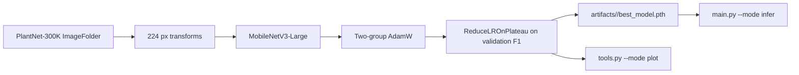

# Flora

Flora classifies plant species from PlantNet-300K. I fine-tune MobileNetV3-Large with a replaced dropout and classification head, split the optimizer so the backbone learns at 1% of the head learning rate, and use Optuna to choose the learning rate, weight decay, and loss. Each run writes its resolved hyperparameters, class names, architecture summary, per-epoch metrics, and checkpoints into `artifacts/<timestamp>_mobilenetv3_large/`. The repository does not include the dataset or a reference checkpoint. The committed comparison figure comes from three runs in my workspace.


_v1, v2, and v3 on the PlantNet-300K validation split. The legend records the batch size, learning rates, weight decay, and epoch count parsed from each run's training script. v3 is the only run that breaks 60% validation top-1._

## Contents

- [Results](#results)
- [Dataset](#dataset)
- [Requirements](#requirements)
- [Reproduce](#reproduce)
- [How it works](#how-it-works)
- [Configuration](#configuration)
- [Project layout](#project-layout)
- [Related projects](#related-projects)
- [Stack](#stack)
- [Limits](#limits)

## Results

| Run | Epochs | Batch | LR backbone / head | Weight decay | Validation top-1 | Validation macro F1 |
| --- | ---: | ---: | ---: | ---: | ---: | ---: |
| v1 | 50 | 256 | 1e-5 / 1e-3 | 0.01 | 36.28% | 37.96% |
| v2 | 40 | 256 | 1e-4 / 1e-2 | 0.1 | 34.18% | 35.28% |
| v3 | 40 | 300 | 1e-5 / 1e-3 | 0.1 | 62.65% | 65.13% |

The protocol is PlantNet-300K's validation split at 224 px with MobileNetV3-Large. The numbers are the best epoch in each run. They come from `vast/v1/training_history.json`, `vast/v2/training_history.json`, and `vast/v3/training_history.json` in my workspace; those directories are not committed. The committed figure is built from the same histories.

The v1 legend says `Epochs: Unknown` because that script sets `n_epochs = 25 * 2`, and the plotting script only reads a constant assignment. The history itself has 50 entries, which is what the table uses. v1 and v2 used cosine annealing; v3 used `ReduceLROnPlateau`. The current CLI uses `ReduceLROnPlateau`, so it reproduces the v3 recipe, not v1 or v2. The v3 run's class mapping (`vast/v3/plant_class_mapping.json`) has 364 entries.

I evaluated the validation split only. The current CLI does not run the test split.

## Dataset

PlantNet-300K contains 306,146 images across 1,081 species. The distribution is long-tailed and many species are visually similar. The dataset is distributed under CC BY 4.0. The archive is 31.7 GB.

Source: [Pl@ntNet-300K on Zenodo](https://zenodo.org/records/5645731), DOI `10.5281/zenodo.5645731`. The accompanying paper is:

> Garcin, Joly, Bonnet, Lombardo, Affouard, Chouet, Servajean, Lorieul, and Salmon. "Pl@ntNet-300K: a plant image dataset with high label ambiguity and a long-tailed distribution." NeurIPS Datasets and Benchmarks, 2021.

`tools.py --mode download` is not implemented. Download the archive from Zenodo and extract it to:

```text
dataset/plantnet_300K/images/
├── train/<species>/*.jpg
├── val/<species>/*.jpg
└── test/<species>/*.jpg
```

`clean.py` removes classes with fewer than 64 training images:

```bash
python clean.py
```

> **Destructive step:** `clean.py` moves whole class folders into `dataset/plantnet_300K/discarded/{train,val,test}`. Run it on a copy if you need the original class layout intact.

In my v3 run the class mapping has 364 entries. The CLI does not hardcode that number; it derives `num_classes` from the training folder.

`tools.py --mode verify` checks that every image opens. It walks both splits and calls `PIL.Image.verify()` on each file, which is slow on the full dataset but catches corrupt files before a long run:

```bash
python tools.py --mode verify
```

## Requirements

- Python 3.10 or newer.
- A CUDA GPU for training. The code falls back to CPU, but 40 epochs over PlantNet-300K on CPU is not practical.
- About 32 GB of disk for the archive, plus room for the extracted images.
- The run histories do not record which GPU was used.

```bash
git clone https://github.com/abderrahmenex86/Flora
cd Flora
python -m venv .venv
source .venv/bin/activate
pip install -r requirements.txt
```

`requirements.txt` is a full environment freeze, not a minimal dependency list. It includes Jupyter, Kaggle, and other tools used during development. I added `optuna` and `torchinfo` because the code imports them and the original freeze did not include them.

## Reproduce

### Weights

The repository does not ship weights. A training run writes:

| File | What it contains |
| --- | --- |
| `best_model.pth` | Best validation macro-F1 state dict |
| `checkpoint_last.pth` | State dict, optimizer, scheduler, epoch, and history from the last epoch |
| `hyperparameters.json` | Resolved arguments |
| `class_names.json` | `ImageFolder` class names |
| `architecture.txt` | `torchinfo` summary |
| `model_history.json` | Per-epoch train and validation metrics |

`src/infer.py` loads `hyperparameters.json`, `best_model.pth`, and `class_names.json`. A run without `best_model.pth` cannot be used for inference.

### Sanity check

```bash
python main.py --mode test
```

This takes five training samples, runs a forward and backward pass, and checks the input shape, output shape, gradients, and the two optimizer parameter groups. The expected final line is:

```text
Sanity checks passed successfully!
```

### Train

This command matches the v3 hyperparameters:

```bash
python main.py --mode train \
  --train_directory dataset/plantnet_300K/images/train \
  --validation_directory dataset/plantnet_300K/images/val \
  --batch_size 300 \
  --learning_rate 0.001 \
  --weight_decay 0.1 \
  --num_epochs 40 \
  --loss_type cross_entropy
```

`--learning_rate` is the head learning rate. The backbone gets 1% of it, so `0.001` becomes `1e-5` for the features and `1e-3` for the classifier. The current trainer also clips gradients at `1.0`; the older v3 script did not, so expect the same recipe rather than a bit-identical replay.

The loop prints one pair of lines per epoch. These are the first-epoch values from the v3 run in my workspace:

```text
Train Metrics | Loss: 1.9633 | Top-1 Acc: 30.51% | Top-5 Acc: 58.00% | Macro F1: 33.71%
Val Metrics   | Loss: 1.2776 | Top-1 Acc: 46.45% | Top-5 Acc: 79.39% | Macro F1: 48.51%
```

The run writes into `artifacts/<timestamp>_mobilenetv3_large/`.

Resume from the last checkpoint:

```bash
python main.py --mode train --resume
```

If `--resume_directory` is omitted, the trainer picks the last directory under `artifacts/`.

Dynamic loader arguments use the `--key=value` form, because `main.py` parses unknown arguments itself:

```bash
python main.py --mode train --num_workers_train=8 --num_workers_validation=4
```

The space-separated form (`--num_workers_train 8`) drops the value and sets the option to `True`.

### Optimize

```bash
python main.py --mode optimize
```

The study runs 10 trials, 10 epochs per trial, on the first 512 training images and the first 128 validation images. It searches `learning_rate` in `[1e-4, 1e-2]` on a log scale, `weight_decay` in `[1e-3, 1e-1]` on a log scale, and `loss_type` in `{cross_entropy, focal}`. It does not search the architecture. Each trial writes its own `model_history.json` under `trial_<n>/`; the study writes `optuna_summary.json` to the run directory and prints the best training command.

### Evaluate

There is no standalone evaluation script. The training loop evaluates the validation split every epoch and writes `model_history.json`. Two utilities read that file:

```bash
python tools.py --mode plot --run_directory artifacts/<run>
```

This writes `training_metrics_plots.png` inside the run directory, with loss, top-1 accuracy, and macro F1 for train and validation.

```bash
python main.py --mode infer \
  --run_directory artifacts/<run> \
  --image_path path/to/image.jpg
```

This prints the predicted class index and label. It does not print a confidence score.

The six-panel comparison figure is not regenerated by `tools.py`. It came from a separate script over the three `vast/` run directories, which are not in the repo.

## How it works

1. `src/dataset.py` builds `ImageFolder` datasets for train and validation and applies the transform pipeline. Training uses `Resize(256)`, `CenterCrop(224)`, horizontal and vertical flips, `ColorJitter(0.3, 0.3)`, float conversion, and ImageNet normalization. Validation uses `Resize(256)`, `CenterCrop(224)`, float conversion, and normalization. The input size is fixed at 224 in code; there is no CLI flag for it.
2. `src/models.py` loads MobileNetV3-Large with ImageNet weights, replaces the dropout with `p=0.5`, and replaces the final linear layer with `Linear(1280, num_classes)`.
3. `src/factory.py` builds a two-group AdamW optimizer: backbone features at `base_lr * 0.01`, classifier at `base_lr`. The scheduler is `ReduceLROnPlateau(mode="max", factor=0.5, patience=4)`, stepped on validation macro F1.
4. The loss is cross-entropy with label smoothing `0.01`, or focal loss with gamma `2.0` when `--loss_type focal` is used.
5. `src/trainer.py` runs the epoch, clips gradients at `1.0`, computes top-1, top-5, and macro F1 with `torchmetrics`, writes `model_history.json` every epoch, saves `best_model.pth` when validation F1 improves, and saves `checkpoint_last.pth` every epoch.
6. `src/optimize.py` builds a new model per trial on the 512/128 subsets and returns the best validation macro F1. Each trial writes its own `model_history.json`; the study writes `optuna_summary.json` to the run directory.
7. `src/infer.py` rebuilds the model from `hyperparameters.json`, loads `best_model.pth`, applies the validation transform, and prints the argmax class.



## Configuration

Command-line arguments:

| Flag | Default | What it does |
| --- | --- | --- |
| `--mode` | required | `test`, `train`, `optimize`, or `infer` |
| `--train_directory` | `dataset/plantnet_300K/images/train` | Training root |
| `--validation_directory` | `dataset/plantnet_300K/images/val` | Validation root |
| `--batch_size` | 32 | Loader batch size |
| `--learning_rate` | `1e-3` | Head learning rate; backbone gets 1% |
| `--weight_decay` | `1e-1` | AdamW weight decay |
| `--num_epochs` | 40 | Training epochs |
| `--loss_type` | `cross_entropy` | `cross_entropy` or `focal` |
| `--resume` | false | Resume from `checkpoint_last.pth` |
| `--resume_directory` | latest run | Run directory to resume from |
| `--run_directory` | none | Inference run directory |
| `--image_path` | none | Inference image |

Dynamic arguments, passed with `=`:

| Argument | Default | What it does |
| --- | --- | --- |
| `--num_workers_train=8` | 12 on CUDA, 0 on CPU | Training loader workers |
| `--num_workers_validation=4` | 4 on CUDA, 0 on CPU | Validation loader workers |
| `--pin_memory_flag=True` | CUDA | Loader pin memory |
| `--prefetch_factor_value=4` | 4 | Loader prefetch factor |
| `--persistent_workers_flag=True` | CUDA when workers are non-zero | Keep workers alive |
| `--gradient_clip_limit=1.0` | 1.0 | Gradient clipping norm |

Artifacts:

| File | What it contains |
| --- | --- |
| `hyperparameters.json` | Resolved arguments |
| `class_names.json` | Class names from the training folder |
| `architecture.txt` | `torchinfo` summary |
| `model_history.json` | Per-epoch loss, top-1, top-5, macro F1 |
| `best_model.pth` | Best validation macro-F1 state dict |
| `checkpoint_last.pth` | Last epoch state, optimizer, scheduler, history |

## Project layout

| Path | What it is |
| --- | --- |
| `main.py` | CLI dispatcher for test, train, optimize, and infer |
| `src/dataset.py` | `ImageFolder` pipelines, transforms, loader settings |
| `src/models.py` | `PlantClassifier` and `MulticlassFocalLoss` |
| `src/factory.py` | Model, loss, optimizer, and scheduler builders |
| `src/trainer.py` | Training and evaluation loop, metrics, checkpoints |
| `src/tester.py` | Five-sample shape, gradient, and optimizer-group check |
| `src/optimize.py` | Optuna study on 512/128 subsets |
| `src/infer.py` | Single-image inference |
| `tools.py` | `verify`, `plot`, and the unimplemented `download` mode |
| `clean.py` | Moves classes with fewer than 64 training images |
| `docs/figs/experiments_comparison_metrics.png` | v1-v3 comparison figure |
| `requirements.txt` | Full environment freeze plus Optuna and torchinfo |

## Related projects

- [Entomi](https://github.com/abderrahmenex86/Entomi) for insect and pest classification
- [Lesioni](https://github.com/abderrahmenex86/Lesioni) for plant disease segmentation

## Stack

| Component | Version / floor | Notes |
| --- | --- | --- |
| Python | 3.10+ | Floor from the project statement |
| PyTorch | 2.11.0 | Pinned in `requirements.txt` |
| torchvision | 0.26.0 | Pinned |
| torchmetrics | 1.9.0 | Pinned |
| Optuna | 3.0+ | Added to the requirements |
| torchinfo | 1.8+ | Added to the requirements |
| matplotlib | 3.10.9 | Pinned |
| numpy | 2.4.4 | Pinned |

## Limits

- `requirements.txt` is an environment freeze that includes Jupyter, Kaggle, and other development tools. A clean install pulls much more than the training path needs.
- The input size is fixed at 224 in `src/dataset.py` and in the model summary. There is no CLI option to change it.
- Optuna searches training hyperparameters only. It does not search the architecture, and it runs on 512 training and 128 validation images for 10 trials of 10 epochs.
- `tools.py --mode download` is not implemented. Download PlantNet-300K manually from Zenodo.
- `tools.py --mode plot` plots one run. The committed three-run comparison figure was generated by a separate script over the `vast/` directories, which are not in the repository, so the figure cannot be regenerated from a clean clone.
- `v1` used `RandomResizedCrop` and `TrivialAugmentWide`; `v2` used the plain resize, center-crop, and flip pipeline without color jitter. Both used cosine annealing. The current CLI reproduces the v3 recipe only.
- `clean.py` moves class folders into `discarded/`. It changes the class count and the split contents, and the move is not undone by any script in the repository.
- The validation split is the only split evaluated. The test split is not wired into the CLI.
- There is no early stopping and no mixed precision. The default run is 40 epochs, so a full run is expensive.
- The v3 run used batch size 300 at 224 px. Reduce it if the GPU cannot hold that batch.
- The run histories do not record the GPU model. I cannot state which card produced v1-v3.
- PlantNet-300K is CC BY 4.0. Cite the dataset paper when you publish results.
